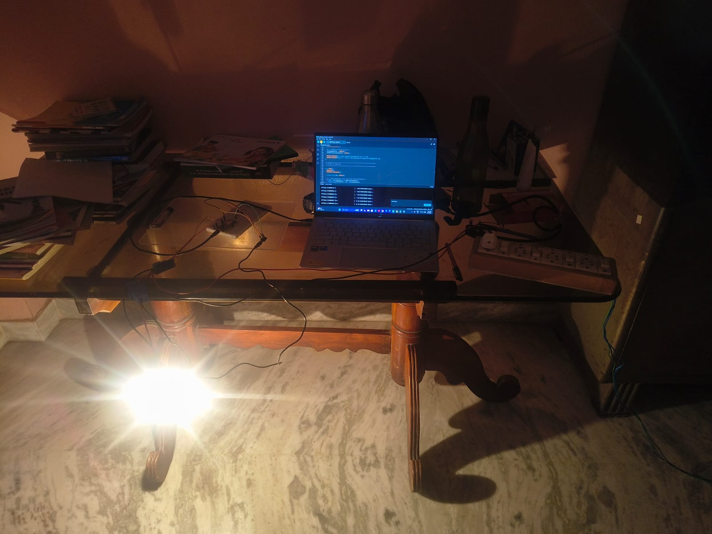
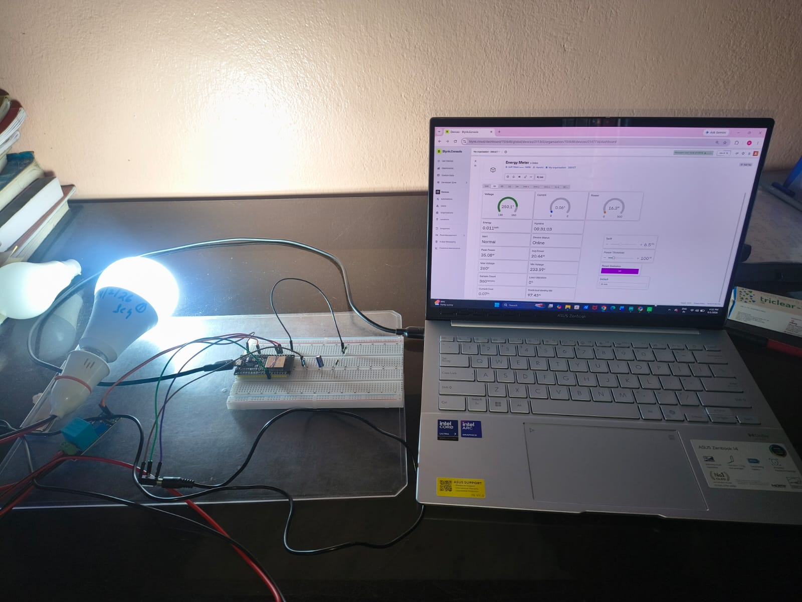
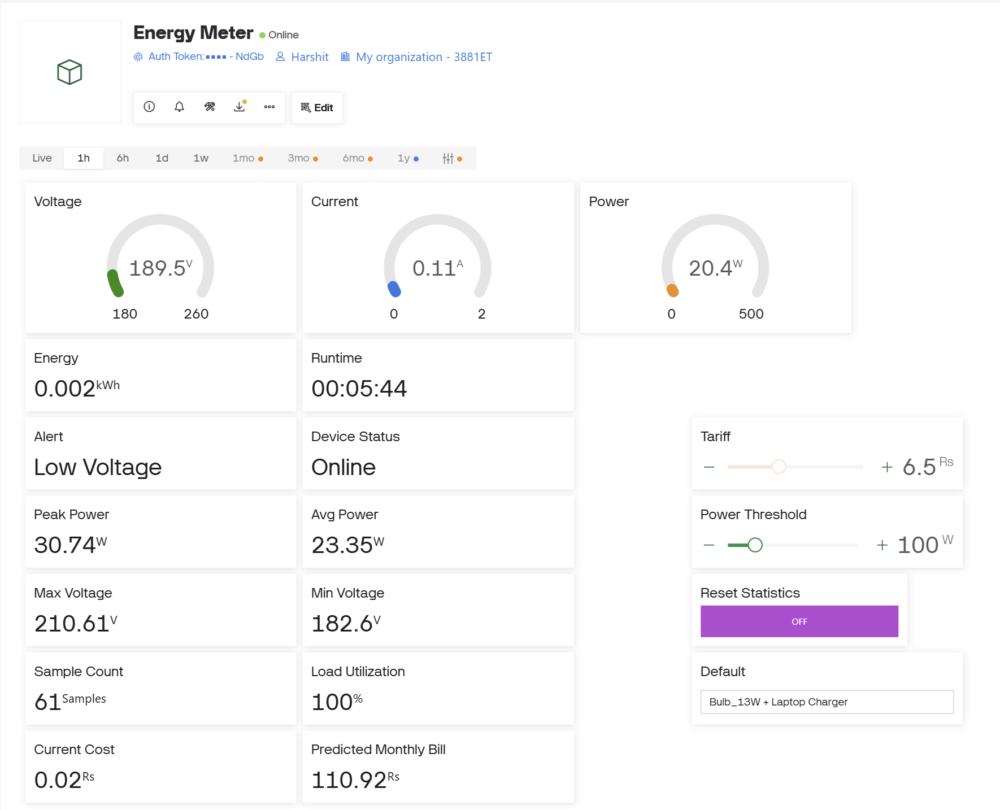
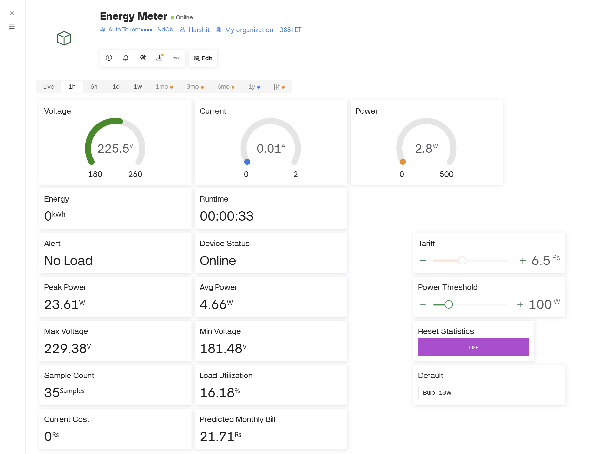

# ⚡ PowerSense: IoT-Based Smart Energy Consumption Monitoring System

[](https://www.espressif.com/)
[](https://blynk.io/)
[](https://workspace.google.com/products/sheets/)
[](https://www.arduino.cc/)
[-orange.svg)](https://dsatm.edu.in/)
[](https://dsatm.edu.in/)

> An end-to-end IoT energy telemetry, load-profiling, and cloud logging system engineered during the **1st Year of Engineering (2025–26)** under the **Innovation Design and Thinking (IDT)** and **Engineering Exploration Course (EEC)** at **Dayananda Sagar Academy of Technology and Management (DSATM), Bengaluru**.

---

## 📌 Table of Contents
- [Project Overview](#-project-overview)
- [Key Features](#-key-features)
- [System Architecture](#-system-architecture)
- [Hardware Setup & Pin Configuration](#-hardware-setup--pin-configuration)
- [Dual-Cloud Telemetry Pipeline](#-dual-cloud-telemetry-pipeline)
  - [Blynk 2.0 Web & Mobile Dashboard](#1-blynk-20-web--mobile-dashboard)
  - [Google Sheets Cloud Logging (Google Apps Script)](#2-google-sheets-cloud-logging-google-apps-script)
- [Mathematical Modeling & Signal Processing](#-mathematical-modeling--signal-processing)
  - [Apparent Power & RMS Computation](#1-apparent-power--rms-computation)
  - [Exponential Moving Average (EMA) Filtering](#2-exponential-moving-average-ema-filtering)
  - [Realistic Predictive Billing Engine](#3-realistic-predictive-billing-engine)
  - [Load Utilization Duty Cycle](#4-load-utilization-duty-cycle)
- [Experimental Methodology & Empirical Results](#-experimental-methodology--empirical-results)
  - [Experimental Configurations](#experimental-configurations)
  - [Measured Results & Comparative Analysis](#measured-results--comparative-analysis)
  - [Key Engineering Discoveries & Findings](#key-engineering-discoveries--findings)
- [Project Directory Structure](#-project-directory-structure)
- [Firmware Setup & Flashing Guide](#-firmware-setup--flashing-guide)
- [Team & Acknowledgments](#-team--acknowledgments)

---

## 📖 Project Overview

Conventional residential and commercial utility meters provide only aggregate kilowatt-hour ($kWh$) figures at the end of a billing cycle. They offer zero real-time visibility into instantaneous demand spikes, power quality fluctuations, standby vampire draw, or appliance-level consumption dynamics.

**PowerSense** addresses this challenge with a cost-effective, dual-cloud IoT monitoring solution powered by an **ESP32 microcontroller**, a **ZMPT101B AC voltage transformer**, and an **SCT-013-030 split-core current transformer**.

The system establishes a concurrent dual-cloud pipeline:
1. **Live Edge Telemetry (5-second cycle):** Streams 19 electrical and financial parameters to an interactive **Blynk 2.0** cloud dashboard featuring real-time gauges, threshold alerts, dynamic tariff sliders, and remote reset triggers.
2. **Automated Cloud Research Database (15-second cycle):** Dispatches HTTPS GET requests directly to **Google Sheets via Google Apps Script**, creating a persistent, time-stamped, experiment-tagged historical database for offline analysis.

---

## 🌟 Key Features

- **⚡ Isolated Dual-Branch Sensing:** Mains AC line voltage monitored via high-precision ZMPT101B transformer, while appliance current is captured non-invasively using an SCT-013-030 clamp.
- **📱 Real-Time Blynk 2.0 Control Plane:** Live gauges for Voltage, Current, Apparent Power, Cumulative Energy ($kWh$), Active Runtime, Real-time Cost ($₹$), and Total Monitoring Time.
- **📊 Automated Serverless Cloud Telemetry:** Telemetry logged to Google Sheets with automated column formatting and experiment tags (e.g., `Bulb_13W`, `Table_Fan`, `Laptop_Charger`).
- **🎯 Dual-Stream Signal Processing (EMA Filter):** Applies an Exponential Moving Average ($\alpha = 0.2$) strictly to display and UI metrics to suppress ADC noise, while preserving unfiltered raw samples for true transient peak capture and energy integration.
- **💡 Observation-Based Predictive Billing:** Projects monthly expenditure using total elapsed monitoring time as the baseline denominator, eliminating the artificial bill inflation of standard "always-on" formulas.
- **📈 Load Utilization Metric:** Quantifies appliance duty cycle:
  $$\text{Load Utilization (\%)} = \left(\frac{\text{Active Runtime}}{\text{Total Monitoring Time}}\right) \times 100$$
- **🛡️ Multi-Condition Anomaly Detection:** Flags Overvoltage ($> 250\text{V}$), Undervoltage ($< 210\text{V}$), Overpower Threshold excursions, and No-Load conditions.
- **💾 Fail-Safe Flash Memory Persistence:** Automatically commits cumulative kilowatt-hours, runtimes, and baseline statistics to ESP32 non-volatile storage (`Preferences` NVS) every 60 seconds to survive power outages.

---

## 🏗️ System Architecture

```mermaid
flowchart TD
    subgraph AC_Circuits ["Electrical Loads Under Test"]
        MAINS["230V AC Mains Supply"]
        LOAD["Target Appliance Load\n(LED Bulb / Fan / Laptop Charger)"]
        MAINS --> LOAD
    end

    subgraph Sensors ["Sensor Interface"]
        ZMPT["ZMPT101B Voltage Transformer\n(Analog ADC1_CH6 / Pin 34)"]
        SCT["SCT-013-030 Split-Core CT\n(Analog ADC1_CH7 / Pin 35)"]
        MAINS -.->|Stepped-down Voltage| ZMPT
        LOAD -.->|Magnetic Induction (Live Conductor)| SCT
    end

    subgraph Controller ["ESP32 Microcontroller Core"]
        SAMPLER["Digital RMS Sampling Engine\n- 2,000 Voltage Samples\n- 1,480 Current Samples"]
        CALC["Math & Signal Processing\n- Apparent Power: S = Vrms x Irms\n- EMA Smoothing (alpha = 0.2)\n- Predictive Billing Engine\n- Load Utilization %"]
        NVS["NVS Flash Memory (Preferences)\nNon-Volatile Backup (Every 60s)"]
        
        ZMPT --> SAMPLER
        SCT --> SAMPLER
        SAMPLER --> CALC
        CALC <--> NVS
    end

    subgraph Cloud ["Dual Cloud Pipeline"]
        BLYNK["Blynk 2.0 Cloud IoT\n(Virtual Pins V0-V18)\nCadence: 5s"]
        APPSCRIPT["Google Apps Script\n(Serverless Web App HTTPS Endpoint)\nCadence: 15s"]
        SHEETS[("Google Sheets Research DB\nTabular Experiment Rows")]
        
        CALC -->|Wi-Fi / TCP| BLYNK
        CALC -->|HTTPS GET| APPSCRIPT
        APPSCRIPT --> SHEETS
    end

    subgraph UI ["User Interfaces"]
        DASH["Blynk Web Console & Mobile App\n(Gauges, Sliders, Overpower Cutoffs)"]
        ANALYTICS["Google Sheets Analytics & Visualizations"]
        
        BLYNK --> DASH
        SHEETS --> ANALYTICS
    end
```

---

## 🔌 Hardware Setup & Pin Configuration

### Bill of Materials (BOM)
| Component | Specification | Function |
| :--- | :--- | :--- |
| **ESP32 DevKit V1** | 30-Pin, Dual-Core 240MHz, 2.4GHz Wi-Fi | Master controller, digital sampling, telemetry |
| **ZMPT101B Module** | On-board micro-voltage transformer & op-amp | AC mains voltage measurement (0–250V AC) |
| **SCT-013-030** | Non-invasive current transformer clamp (30A / 1V) | Safe current induction around live conductor |
| **DT830D Multimeter** | Digital Multimeter | Laboratory reference benchmark for calibration |
| **Prototyping Board** | Solderless breadboard & jumper leads | Signal conditioning & module routing |
| **AC Test Bench** | Isolated terminal block, inline bulb fixture | Safe, controlled electrical testing environment |

### Microcontroller Pin Mapping
| ESP32 Pin | Connected Module | Mode | Description |
| :--- | :--- | :--- | :--- |
| **GPIO 34** (ADC1_CH6) | ZMPT101B Analog Output | Input | Dedicated ADC1 channel for AC voltage RMS sampling |
| **GPIO 35** (ADC1_CH7) | SCT-013-030 Analog Output | Input | Dedicated ADC1 channel for AC current RMS sampling |
| **3V3 / VIN** | Module Power Rails | Power | Regulated 3.3V / 5V DC supply |
| **GND** | System Ground Rail | Ground | Common reference ground plane |

| Experimental Test Bench | Breadboard Signal Interface |
| :---: | :---: |
|  |  |

---

## ☁️ Dual-Cloud Telemetry Pipeline

### 1. Blynk 2.0 Web & Mobile Dashboard

The Blynk interface enables continuous remote supervision and dynamic parameter control:

| Virtual Pin | Parameter Name | Unit | Type | Direction | Functional Description |
| :---: | :--- | :---: | :---: | :---: | :--- |
| **V0** | Voltage | V | Double | Output | EMA-smoothed AC RMS voltage |
| **V1** | Current | A | Double | Output | EMA-smoothed AC RMS current |
| **V2** | Apparent Power | VA | Double | Output | EMA-smoothed instantaneous apparent power ($S$) |
| **V3** | Cumulative Energy | kWh | Double | Output | True cumulative electrical energy |
| **V4** | Load Runtime | HH:MM:SS | String | Output | Total elapsed time load current $> 30\text{mA}$ |
| **V5** | Current Cost | ₹ (INR) | Double | Output | Real-time accumulated cost ($\text{kWh} \times \text{Tariff}$) |
| **V6** | Predicted Monthly Bill | ₹ (INR) | Double | Output | Observation-time projected monthly bill |
| **V7** | Alert Message | — | String | Output | Overvoltage, undervoltage, or load status string |
| **V8** | Device Status | — | String | Output | Connectivity state (`Online` / `Offline`) |
| **V9** | Peak Apparent Power | VA | Double | Output | Maximum recorded transient power spike |
| **V10** | Max Voltage | V | Double | Output | Maximum recorded grid voltage excursion |
| **V11** | Min Voltage | V | Double | Output | Minimum recorded grid voltage dip |
| **V12** | Average Power | VA | Double | Output | Running mean apparent power |
| **V13** | Sample Count | — | Integer | Output | Total sampling cycles completed |
| **V14** | Tariff Slider | ₹/kWh | Double | Input | User-configurable electricity price (Default: ₹6.50) |
| **V15** | Reset Button | — | Integer | Input | Remote trigger to clear accumulated flash memory |
| **V16** | Power Threshold Slider | VA | Double | Input | User-configurable high-power alarm trip point |
| **V17** | Total Monitoring Time | HH:MM:SS | String | Output | Total elapsed time since boot / last reset |
| **V18** | Load Utilization | % | Double | Output | Percentage of monitoring time load was active |

| Multi-Load Telemetry Dashboard | Low-Load Composite Test |
| :---: | :---: |
|  |  |

---

### 2. Google Sheets Cloud Logging (Google Apps Script)

Every 15 seconds, the ESP32 dispatches an HTTPS GET request to a serverless Google Apps Script Web App endpoint. The endpoint automatically writes structured records directly into a Google Sheet:

```
https://script.google.com/macros/s/AKfy.../exec?experimentID=Bulb_13W&timestamp=120&voltage=229.4&current=0.061&power=14.0&energy=0.00047...
```

The script manages automated tabular headers on first launch, appends the Google server timestamp, and formats numbers for immediate export to Python, MATLAB, or Excel. Full implementation details are in [`google-apps-script/Code.gs`](google-apps-script/Code.gs).

---

## 🧮 Mathematical Modeling & Signal Processing

### 1. Apparent Power & RMS Computation

Because the ZMPT101B voltage module is permanently installed across the mains terminal block while the SCT-013-030 current clamp is physically relocated across different appliance cords during testing, the sensors are not guaranteed to sample from a singular synchronized electrical branch. 

To adhere strictly to electrical metrological integrity, the firmware computes and reports **Apparent Power ($S$)**:

$$V_{\text{RMS}} = \sqrt{\frac{1}{N} \sum_{i=1}^{N} \left(V_i - V_{\text{mid}}\right)^2} \times K_v \quad (N = 2000)$$

$$I_{\text{RMS}} = \text{calcIrms}(1480) \times K_i$$

$$\mathbf{S \text{ (VA)}} = V_{\text{RMS}} \times I_{\text{RMS}}$$

*No simulated active power ($W$), synthetic power factor, or reactive power is fabricated.*

### 2. Exponential Moving Average (EMA) Filtering

To eliminate ADC quantization jitter and noise without damping real electrical transients, a selective EMA filter is applied:

$$y[n] = \alpha \cdot x[n] + (1 - \alpha) \cdot y[n-1] \quad (\alpha = 0.2)$$

- **Display & Logging Streams:** Smoothed via EMA for stable UI gauges.
- **Energy Integration & Peak Detection:** Executed exclusively on raw, un-smoothed samples to preserve true transient surges and maintain exact cumulative energy totals.

### 3. Realistic Predictive Billing Engine

Conventional energy meters estimate monthly bills using instantaneous power multiplied across 720 hours ($\text{Power} \times 720\text{h} \times \text{Tariff}$). For intermittent or varying loads, this produces heavily inflated, unrealistic projections.

PowerSense implements an **observation-time averaging model**:

$$\text{Hourly Observed Rate (kWh/h)} = \frac{\text{Cumulative Energy (kWh)}}{T_{\text{monitoring}} \text{ (hours)}}$$

$$\mathbf{\text{Predicted Monthly Bill (₹)}} = \text{Hourly Observed Rate} \times 720\text{ hours} \times \text{Tariff (₹/kWh)}$$

This approach reflects actual observed duty cycles, factoring in idle periods and usage variations.

### 4. Load Utilization Duty Cycle

$$\mathbf{\text{Load Utilization (\%)}} = \left(\frac{T_{\text{runtime}}}{T_{\text{monitoring}}}\right) \times 100$$

Where $T_{\text{runtime}}$ increments only when load current exceeds the calibrated no-load noise floor ($I_{\text{RMS}} > 0.03\text{A}$).

---

## 🔬 Experimental Methodology & Empirical Results

### Experimental Configurations

The system was evaluated in laboratory trials across five distinct load configurations:

| Experiment ID | Tested Load Configuration | Status | Experimental Objective |
| :--- | :--- | :---: | :--- |
| **E1** | 26 W incandescent bulb | **Included** | Single continuous resistive baseline load |
| **E2** | 13 W LED bulb + Laptop charger | **Included** | Dual-load, low-current composite draw |
| **E3** | 13 W LED bulb + Laptop charger + Table fan | **Included** | Triple-load composite draw with inductive motor |
| **Excl-1** | 13 W LED bulb (standalone) | *Excluded\** | Sensor dynamic range evaluation |
| **Excl-2** | 100 W incandescent bulb | *Excluded\** | Sensor dynamic range evaluation |

*\*Note on Excluded Trials:* Excl-1 and Excl-2 were conducted to identify current-transformer low-current response limits and exhibited progressive secondary signal decay under small loads near the noise floor, as detailed in the discoveries below.

---

### Measured Results & Comparative Analysis

The table below summarizes the empirical session statistics logged directly to the cloud research database at the conclusion of each trial:

| Metric | E1 (26 W Bulb) | E2 (13 W Bulb + Charger) | E3 (13 W + Charger + Fan) |
| :--- | :---: | :---: | :---: |
| **Total Monitoring Time** | `00:31:33` | `00:12:07` | `00:06:44` |
| **Load-Active Runtime** | `00:31:23` | `00:03:58` | `00:06:44` |
| **Load Utilization (%)** | **99.5%** | **32.7%\*** | **100.0%** |
| **Average Apparent Power** | **20.4 VA** | **6.6 VA** | **23.1 VA** |
| **Peak Apparent Power** | **35.1 VA** | **23.8 VA** | **32.1 VA** |
| **Voltage Range (Min – Max)** | $233.6\text{ V} - 273.0\text{ V}$ | $183.6\text{ V} - 221.2\text{ V}$ | $182.6\text{ V} - 210.6\text{ V}$ |
| **Cumulative Energy** | $0.01094\text{ kWh}$ | $0.00138\text{ kWh}$ | $0.00266\text{ kWh}$ |
| **Telemetry Sample Count** | 364 | 132 | 73 |

*\*See discussion below regarding the E2 load utilization figure.*

---

### Key Engineering Discoveries & Findings

#### 1. Load Utilization as an Actionable Behavioral Indicator
In trial **E1** (26W resistive bulb), Load Utilization measured **99.5%**, reflecting uninterrupted continuous draw. In trial **E3**, adding the table fan yielded **100.0%** utilization. These results demonstrate that at operational currents above the sensor noise floor, **Load Utilization serves as a clear behavioral indicator**, enabling users and energy auditors to distinguish continuous standby loads from intermittent appliances far more effectively than cumulative kilowatt-hours alone.

#### 2. Supply Voltage Variations & Composite Load IR-Drop
- Trial **E1** operated within an elevated grid voltage band of **$233.6\text{–}273.0\text{V}$**.
- Trials **E2** and **E3** operated within lower voltage bands (**$183.6\text{–}221.2\text{V}$** and **$182.6\text{–}210.6\text{V}$** respectively), with the absolute minimum occurring under the triple-load configuration.
- While session-to-session utility line fluctuations cannot be completely decoupled, the downward voltage trend is directionally consistent with localized wiring impedance drop (IR-drop) as cumulative branch current increases.

#### 3. Magnetic Field Cancellation on Two-Conductor Cords
Early attempts to clamp the SCT-013 current transformer directly around intact, two-conductor appliance zip cords (laptop charger and table fan) resulted in near-zero readings.
- **Physical Cause:** A standard appliance cord bundles both Live and Neutral conductors side-by-side. Because currents flow in equal and opposite directions through the two wires, their induced magnetic fields cancel each other out ($B_{\text{net}} \approx 0$).
- **Engineering Solution:** The current transformer clamp must encircle **only the isolated Live conductor**. Isolating the live wire on the test bench restored strong, accurate secondary induction.

#### 4. Sensor Dynamic Range Mismatch at Low Loads
- The SCT-013-030 current transformer is rated for **$100\text{A} / 50\text{mA}$** (or $30\text{A} / 1\text{V}$), designed for panel-level monitoring.
- Small household loads (13W–100W drawing $\approx 0.05\text{A} - 0.45\text{A}$) operate at under **1.5% of the sensor's full-scale rated capacity**.
- In trial **E2**, current samples fluctuated tightly around the firmware's $0.03\text{A}$ no-load threshold ($0.022\text{A} - 0.072\text{A}$), causing the load utilization calculation to dip to $32.7\%$ due to sensor noise rather than genuine physical switching.
- **Key Takeaway:** For sub-50W appliance monitoring, pairing the ESP32 with a lower-range current transformer (e.g., 5A/1V or multi-turn primary windings) is recommended to optimize ADC resolution.

---

## 📁 Project Directory Structure

```
PowerSense-IoT-Energy-Monitor/
│
├── firmware/
│   └── PowerSense_ESP32/
│       └── PowerSense_ESP32.ino    # Complete ESP32 production firmware
│
├── google-apps-script/
│   ├── Code.gs                     # Google Apps Script Web App telemetry receiver
│   └── README.md                   # Google Sheets setup and deployment guide
│
├── images/                         # Test bench photography and Blynk dashboard captures
│   ├── blynk_dashboard_bulb.png
│   ├── blynk_dashboard_bulb_laptop.png
│   ├── blynk_dashboard_fan.png
│   ├── circuit_test_bench.jpg
│   ├── hardware_setup_close.jpg
│   └── hardware_setup_wide.jpg
│
├── .gitignore                      # Git exclusion rules
└── README.md                       # Master repository documentation
```

---

## 🚀 Firmware Setup & Flashing Guide

### Hardware & Software Prerequisites
1. **Arduino IDE 2.x** with the **ESP32 Board Package** installed (`esp32` by Espressif Systems).
2. Required Arduino Libraries (available via Library Manager):
   - `Blynk` (v1.3.0 or higher)
   - `EmonLib` (v1.1.0 or higher)
   - `Preferences.h` (ESP32 core built-in)
   - `WiFi.h` & `HTTPClient.h` (ESP32 core built-in)

### Step-by-Step Configuration
1. Open [`firmware/PowerSense_ESP32/PowerSense_ESP32.ino`](firmware/PowerSense_ESP32/PowerSense_ESP32.ino) in Arduino IDE.
2. Configure your Wi-Fi network and Blynk 2.0 template credentials (lines 55–75):
   ```cpp
   #define BLYNK_TEMPLATE_ID   "YOUR_TEMPLATE_ID"
   #define BLYNK_TEMPLATE_NAME "PowerSense"
   #define BLYNK_AUTH_TOKEN    "YOUR_AUTH_TOKEN"

   char WIFI_SSID[] = "YOUR_WIFI_NAME";
   char WIFI_PASS[] = "YOUR_WIFI_PASSWORD";
   ```
3. Set your deployed Google Apps Script Web App URL (line 78):
   ```cpp
   const char* GOOGLE_SCRIPT_URL = "https://script.google.com/macros/s/YOUR_SCRIPT_ID/exec";
   ```
4. Set your experiment tag (line 73):
   ```cpp
   String experimentID = "Bulb_13W_Test";
   ```
5. Connect your ESP32 via micro-USB, select board **ESP32 Dev Module**, choose the correct COM port, and click **Upload**.

---

## 👥 Team & Acknowledgments

### Project Team (1st Year B.Tech CSE, 2025–26)
- **Harshit Agarwalla** (1DT25CS110) — *Team Lead, Firmware Architecture, Blynk & Google Sheets Cloud Telemetry*
- **Dewanshu Dutt Thakur** (1DT25CS084) — *Hardware Prototyping & Sensor Calibration*
- **Gouravi Nayak** (1DT25CS104) — *Empirical Data Collection & Results Analysis*
- **Ibbani S** (1DT25CS116) — *Experimental Testing & Metrics Verification*
- **Karnika Jain** (1DT25CS127) — *Component Sourcing & Circuit Prototyping*

### Academic Mentorship
- **Project Guide:** Dr. Anjana Devi S C, Associate Professor, DSATM Bengaluru
- **Course Coordinator:** Dr. Roopa R Kulkarni, DSATM Bengaluru
- **Institution:** Department of Computer Science & Engineering, **Dayananda Sagar Academy of Technology and Management (DSATM)**, Bengaluru.
